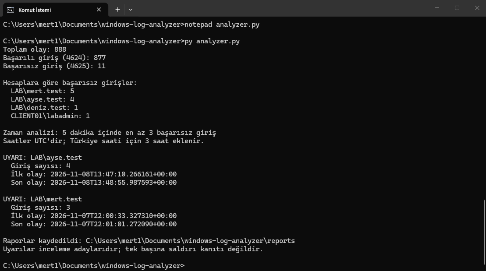
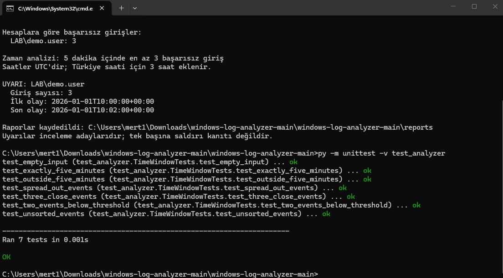

# Windows Log Analyzer

Windows güvenlik olaylarının XML dışa aktarımını inceleyen Python uygulaması.

Active Directory laboratuvarımdan alınan kayıtlarla geliştirdiğim bu araç, başarılı ve başarısız girişleri sayar; başarısız girişleri hesap bazında özetler ve kısa sürede tekrarlanan denemeleri işaretler.

## Özellikler

- 4624 başarılı oturum açma kayıtlarının sayılması.
- 4625 başarısız oturum açma kayıtlarının sayılması.
- Başarısız girişlerin domain ve kullanıcı adına göre gruplanması.
- Hesap adlarındaki büyük/küçük harf farklarının birleştirilmesi.
- Aynı hesap için herhangi bir 5 dakikalık aralıkta en az 3 başarısız giriş olduğunda uyarı üretilmesi.
- Her hesap için en yoğun aralığın raporlanması.
- CSV özet ve uyarı dosyalarının oluşturulması.
- Eksik veya geçersiz zaman bilgilerinin bildirilmesi.

Uyarılar inceleme adaylarıdır; tek başına saldırı kanıtı değildir.

## Gereksinimler

- Python 3.11 veya üzeri.
- Harici paket kurulumu gerekmez; Python standart kütüphanesi kullanılır.

Laboratuvar çalıştırmaları Windows 11 üzerinde gerçekleştirilmiştir.

## Örnek Verilerle Çalıştırma

Depoyu indirip ZIP dosyasını ayıkladıktan sonra proje klasöründe Komut İstemi açın.

Aşağıdaki komutları sırayla çalıştırın:

```cmd
if not exist data mkdir data
copy examples\security-events.xml data\security-events.xml
py analyzer.py
```

Kopyalama komutu, varsa `data/security-events.xml` dosyasının üzerine yazmak için onay isteyebilir. Kendi loglarınız varsa önce yedekleyin.

### Beklenen Sonuç

- Toplam olay: 4
- Başarılı giriş: 1
- Başarısız giriş: 3
- LAB\demo.user hesabı için bir uyarı
- Uyarı aralığı: 10:00:00–10:02:00 UTC

`examples/security-events.xml` eğitim için hazırlanmış sentetik veridir. Tam bir Windows olay kaydının yalnızca analizde kullanılan alanlarını içerir.

## Kendi Loglarınızla Kullanım

1. Windows Olay Görüntüleyicisi'ni uygun yönetici yetkileriyle açın.
2. Windows Günlükleri → Güvenlik bölümünde 4624 ve 4625 olaylarını filtreleyin.
3. Filtrelenmiş günlüğü XML biçiminde dışa aktarın.
4. Dosyayı proje içindeki `data/security-events.xml` konumuna koyun.
5. `py analyzer.py` komutunu çalıştırın.

Araç dışa aktarılmış dosyayı inceler; canlı izleme yapmaz.

## Çıktılar

| Dosya | İçerik |
|---|---|
| reports/failed-logins-summary.csv | Hesap başına toplam başarısız giriş |
| reports/alerts.csv | Eşiği karşılayan hesapların en yoğun zaman aralığı |

CSV dosyaları noktalı virgül ayırıcı ve UTF-8 BOM kodlaması kullanır. Her çalıştırmada mevcut raporlar güncellenir.

Zamanlar UTC olarak raporlanır. Türkiye saati için 3 saat eklenir.

## Uyarı Mantığı

Başarısız girişler hesap bazında ayrılır ve zamanlarına göre sıralanır. Kayan zaman penceresi kullanılarak herhangi bir 300 saniyelik aralıktaki en yüksek olay sayısı bulunur.

- Eşik: En az 3 başarısız giriş.
- Tam 300 saniye aralığı kapsama dahildir.
- Her hesap için yalnızca en yoğun aralık raporlanır.
- Eşit yoğunlukta aralıklar varsa ilk bulunan korunur.
- Zamanı okunamayan kayıtlar toplam sayımda kalır, zaman analizine alınmaz.
- Bilinmeyen hesaplar zaman uyarısı üretmek için birleştirilmez.

Bu eşik eğitim amacıyla seçilmiştir.

## Testler

```cmd
py -m unittest -v test_analyzer
```

Zaman penceresi fonksiyonu için 7 birim testi bulunmaktadır:

- Birbirine yakın üç olay.
- Eşik altında kalan iki olay.
- Zamana yayılmış olaylar.
- Tam beş dakikalık sınır.
- Beş dakika sınırının aşılması.
- Sırasız olaylar.
- Boş olay listesi.

Laboratuvar çalıştırmasında 7 testin tamamı geçmiştir. Bu testler zaman penceresi fonksiyonunu kapsar; XML okuma ve CSV yazma için uçtan uca test değildir.

## Laboratuvar Gözlemleri

Kendi laboratuvarımdan dışa aktardığım dosyada:

- 888 olay okundu.
- 877 başarılı giriş kaydı bulundu.
- 11 başarısız giriş kaydı bulundu.
- İki hesap zaman aralığı eşiğini karşıladı.
- Özet ve uyarı CSV dosyaları oluşturuldu.

Başarılı giriş sayısı farklı kişi sayısını göstermez; sistem ve servis hesapları da dahil olabilir.

## Sınırlamalar

- Kaynak IP, giriş türü ve hata nedenine göre ayrım yapılmaz.
- Tekrarlanan kayıtlar otomatik ayıklanmaz.
- Hesap kilitlenmesi gibi farklı başarısızlık nedenleri ayrı sınıflandırılmaz.
- Program bir SIEM veya gerçek zamanlı saldırı tespit sistemi değildir.

## Veri Kullanımı

Gerçek log dosyaları ve bu dosyalardan oluşturulan raporlar yerel kullanım içindir. Depoda paylaşılabilir örnek olarak sentetik XML verisi bulunur.

## İlgili Proje

[Active Directory Güvenlik Laboratuvarı](https://github.com/Raskeria/active-directory-security-lab)
## Ekran Görüntüleri

### Laboratuvar Log Analizi

Gerçek laboratuvar kayıtlarında 888 olay incelendi. Hesap bazında başarısız girişler sayıldı ve iki hesap için zaman aralığı uyarısı üretildi.



### Sentetik Örnek ve Birim Testleri

GitHub’dan indirilen sürüm, sentetik örnekte demo.user için beklenen uyarıyı üretti. Zaman penceresi fonksiyonuna ait 7 testin tamamı geçti.


